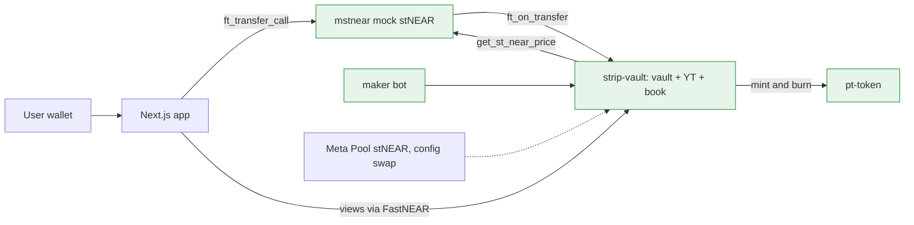
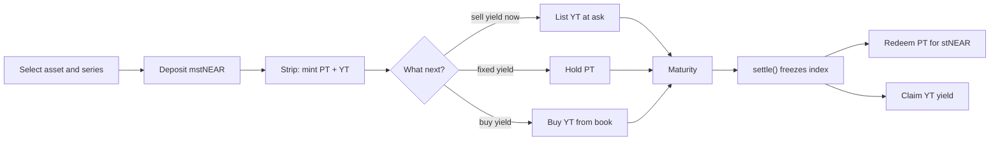

# Rhea Strip

Yield stripping for NEAR liquid staking assets. Rhea Strip takes a yield-bearing token, splits it into a Principal Token (PT) and a Yield Token (YT), and lets users trade either side. The flagship flow is **selling future yield**: a YT holder lists YT at the implied APY they will accept, a second account pays mstNEAR up front, takes over the yield from that moment, and the seller keeps the interest earned before the sale. At maturity anyone settles the series, PT redeems for the underlying at the frozen index, and YT holders claim the yield they accrued.

Built for NEAR HACKATHON 2026. Testnet only. Not audited.

## Reviewer quick view (60 seconds)

| | |
|---|---|
| **Problem** | Staking yield is locked inside the staked token. You cannot sell next month's yield today, and you cannot lock in a fixed return. |
| **Product** | A vault splits a staked NEAR token into PT (principal) and YT (yield). Either side trades on its own. Flagship flow: a YT holder sells future yield for mstNEAR now; the buyer earns from the fill onward, the seller keeps what she earned before. |
| **Verify with no wallet and no keys** | `pnpm install && pnpm test:sdk && pnpm e2e:fake` ends with `e2e:fake OK (all five PRD success criteria, conservation and attribution asserted)`. Then `pnpm dev` and open `http://localhost:3000`. |
| **Verify on NEAR testnet** | Vault and YT [`strip.rhea-strip.testnet`](https://testnet.nearblocks.io/address/strip.rhea-strip.testnet), PT [`pt.rhea-strip.testnet`](https://testnet.nearblocks.io/address/pt.rhea-strip.testnet), mock stNEAR [`mstnear.rhea-strip.testnet`](https://testnet.nearblocks.io/address/mstnear.rhea-strip.testnet). Read the live series: `curl -s https://test.rpc.fastnear.com -H 'content-type: application/json' -d '{"jsonrpc":"2.0","id":1,"method":"query","params":{"request_type":"call_function","finality":"final","account_id":"strip.rhea-strip.testnet","method_name":"get_series","args_base64":"e30="}}'` |
| **Real testnet flow** | `pnpm dev:testnet`, click **Connect**, pick a demo account (Alice or Bob) or your own wallet. Strip, list YT, buy, withdraw, settle, redeem and claim are real transactions with explorer links in the stepper. |
| **Honest limits** | Mock yield on a demo clock (one hour is one protocol year), offer book instead of an AMM, testnet only, not audited. Details in the next section. |
| **Tests** | 22 SDK tests, Rust unit and NEAR sandbox tests for the three contracts, Playwright specs for the demo path, every route, four viewport widths, accessibility and reduced motion. |

## What is real and what is mocked

Read this first. The demo is honest about its simplifications.

| Piece | Status |
|---|---|
| `strip-vault` contract (vault, YT token, offer book, settlement) | Real Rust contract (near-sdk 5.30.1), deployed on NEAR testnet, integer math only (U256/U512 mul-div), tested in unit tests and in a NEAR sandbox |
| `pt-token` contract (PT) | Real NEP-141 with a minter gate (the vault is the only minter) |
| Underlying token `mstnear` | **Mock.** A NEP-141 with the Meta Pool stNEAR interface (`get_st_near_price`, NEP-145 registration, non-rebasing). Its price rises on a schedule (8% APR, set by `apr_bps`) because the real testnet stNEAR price has been frozen since 2026-07-23 |
| Time | **Demo clock.** `year_secs` is 3600: one real hour is one protocol year, so yield and maturity are visible in minutes. Every APY label in the UI uses this clock |
| Trading venue | **Offer book inside the vault**: maker-priced, full fills only, no fees, no on-chain pricing math. It is not an AMM; the time-decaying AMM is listed as future expansion in the PRD |
| Market depth | A maker bot account (`maker.rhea-strip.testnet`) seeds a few offers with `pnpm seed-maker`; everything else is real offers between real accounts |
| Mainnet stNEAR price and APY on the landing page | Real, read-only view call on `meta-pool.near`, shown for reference |
| Network | NEAR testnet only. No mainnet deployment. No audit. Do not use real funds |
| Fake mode (`pnpm dev`) | An in-memory simulation of the three contracts in TypeScript (same integer math), with an account switcher (Alice, Bob, Maker) and a demo clock panel. It needs no wallet and is the guaranteed path to see the whole flow |

NEAR's role: the vault and tokens are NEAR contracts, the yield source is a NEP-141 liquid staking token whose price is read with a cross-contract call inside the strip and buy flows, and the app signs through NEAR wallets (`@hot-labs/near-connect`) on testnet.

Related work: another public hackathon project, `github.com/ayoubbuoya/exodus-near`, also tokenizes NEAR liquid staking tokens into PT and YT and trades them through a Pendle-style AMM. Rhea Strip takes a different trading path (a maker-priced offer book with forward-selling of yield as the main flow) and a faithful Meta Pool stNEAR interface for the underlying.

## Architecture



Three new contracts. The real Meta Pool contract plugs in through the underlying account id (dotted line); the vault does not change.



Accounting in one paragraph: the index is the underlying price (24 decimals, never decreases, lazy sync). Stripping `sy` stNEAR at index `I` mints `floor(sy * I / 1e24)` PT and the same amount of YT. A YT holder accrues `balance * (1/I_prev - 1/I_now)` stNEAR; the ledger is settled for both parties before any YT balance change, so a seller keeps what she earned before a fill. After `settle()` freezes the maturity index, PT redeems `floor(pt * 1e24 / maturity_index)` and YT claims its accrual and is burned. Every payout rounds down in the vault's favour. The full interface is in `docs/handoffs/contracts.md`.

## Prerequisites

- Node.js 22.22 or newer (developed on 26; `near-api-js` 7 requires it), pnpm 11 (`corepack enable` or `npm i -g pnpm@11`)
- Rust 1.95 or newer for the contracts (the repo pins 1.99.1 in `contracts/rust-toolchain.toml` and needs the `wasm32-unknown-unknown` target)
- Only for building and deploying contracts: `cargo-near` 0.23 and `near-cli-rs` 0.31 (`cargo install --locked cargo-near near-cli-rs`)
- Only for the browser tests: Google Chrome (the Playwright specs use the system Chrome, no browser download)

## Quick start: do X, see Y

Run these from the repository root, in order. Steps 1 to 4 need no wallet, no keys and no network access beyond the package registry.

| # | Command | You should see |
|---|---|---|
| 1 | `pnpm install` | `Done` with no errors |
| 2 | `pnpm test:sdk` | `Test Files 3 passed (3)` and `Tests 22 passed (22)`: pricing formulas (including the worked check r=8%, tau=0.5, index 1.5144 gives pPT 0.9623 and an ask of about 2.49 per 100 YT), the fake chain, the 100 stNEAR at index 1.5 to 1.6 worked vector (6.25 stNEAR accrued) |
| 3 | `pnpm e2e:fake` | A 13-row table (faucet, strip 50 mstNEAR, sell 20 YT, list and buy PT, withdraw, settle, redeem, claim) ending with `e2e:fake OK (all five PRD success criteria, conservation and attribution asserted)` |
| 4 | `pnpm dev` | Next.js serving `http://localhost:3000` in fake mode. Open it and follow "The demo path" below |
| 5 | `pnpm test:qa` | Playwright (system Chrome) starts its own dev server on port 3107 and runs the demo path, a smoke test per route, a viewport sweep (390, 810, 1200, 1440), accessibility checks and a reduced-motion check. Results and the known failure are in the Review section of `docs/handoffs/STATUS.md` |
| 6 | `pnpm build:contracts` | Three wasm files under `contracts/target/near/` (`mock_stnear`, `pt_token`, `strip_vault`). Heavy: one cargo build at a time. If `cargo near` cannot find the wasm target, run it with `PATH=$HOME/.cargo/bin:$PATH` |
| 7 | `pnpm test:contracts` | `cargo test --workspace`: unit tests for the three contracts plus the sandbox suite in `contracts/tests` (needs step 6 first; the sandbox binary is downloaded on first run) |

### The demo path (fake mode, three minutes)

1. Open `/`. See the hero ("Split yield from principal. *Trade* either side."), the series card labelled "Mock stNEAR, demo clock" with a maturity countdown, and the mainnet stNEAR reference price. Click **Launch app**.
2. `/strip`, acting as Alice (header selector): click **Get test mstNEAR** (balance becomes 100), enter 10, see the PT (ice) and YT (pink) preview, click **Strip mstNEAR**. The stepper confirms and the PT and YT amounts appear.
3. `/trade`, YT tab, **Sell future yield**: enter 5 YT, drag the implied APY slider (the upfront mstNEAR preview moves), click **List YT**.
4. Open the **Demo clock** panel (bottom right), click **+1 minute**, close it. Switch the header selector to Bob, get test mstNEAR on `/strip`, go to `/trade` and click **Buy** on Alice's offer. Bob holds 5 YT.
5. Switch back to Alice, open `/portfolio`: PT balance, remaining YT, the sale credit. Click **Withdraw**: her mstNEAR balance rises by the ask.
6. Demo clock, **Jump to maturity**, open `/settle`: settlement runs by itself. Click **Redeem PT** and **Claim YT**.
7. Switch to Bob on `/settle` and click **Claim YT**: he receives only the yield accrued since his fill. Alice's pre-fill interest stayed with her. On `/portfolio` PT and YT are zero and the mstNEAR balance holds principal plus yield.

Fake-mode state lives in memory: a full page reload resets it. Use the header links, not the browser address bar, once you start.

How the five PRD success criteria map to the app: deposit (`/strip`), receive PT and YT (`/strip` success card, `/portfolio`), hold and trade independently (`/trade` PT and YT tabs), sell future yield (`/trade` hero), redeem and claim at maturity (`/settle`). `pnpm e2e:fake` asserts all five headlessly.

## Testnet deployment

Deployed on NEAR testnet (root account `rhea-strip.testnet`, from `deployments/testnet.json`):

| Contract | Account | Explorer |
|---|---|---|
| Mock stNEAR (`mstNEAR`) | `mstnear.rhea-strip.testnet` | https://testnet.nearblocks.io/address/mstnear.rhea-strip.testnet |
| PT token | `pt.rhea-strip.testnet` | https://testnet.nearblocks.io/address/pt.rhea-strip.testnet |
| Strip vault (also the YT token) | `strip.rhea-strip.testnet` | https://testnet.nearblocks.io/address/strip.rhea-strip.testnet |
| Maker bot | `maker.rhea-strip.testnet` | https://testnet.nearblocks.io/address/maker.rhea-strip.testnet |

Read the live series without a wallet (any NEAR RPC client works; this uses FastNEAR):

```bash
curl -s https://test.rpc.fastnear.com -H 'content-type: application/json' -d '{"jsonrpc":"2.0","id":1,"method":"query","params":{"request_type":"call_function","finality":"final","account_id":"strip.rhea-strip.testnet","method_name":"get_series","args_base64":"e30="}}'
```

The result is a byte array of the `get_series` JSON (status, maturity, index, supplies).

Testnet commands (these need `near-cli-rs` and keys in the OS keychain; keys are never stored in the repo):

| Command | What it does |
|---|---|
| `pnpm demo:reset` | Redeploys a fresh 10-minute series and seeds maker offers: run it right before a live demo |
| `pnpm new-series -- --minutes 10` | Redeploys the vault and PT with a new maturity (add `--seed` to seed offers) |
| `pnpm seed-maker` | The maker account strips and lists YT and PT offers |
| `pnpm keeper` | Calls `sync_index` every 15 s and `settle` once matured. Run it during a testnet demo so "YT yield accrued" ticks: the vault stores the index and only updates it on a sync |
| `pnpm e2e:testnet` | Runs the five PRD criteria against the live series with two accounts and prints explorer links. Needs an Active series with at least 4 minutes left, so run `pnpm new-series -- --minutes 10` first, and it waits for maturity |
| `pnpm deploy:testnet` | Creates the root and sub-accounts, deploys the three contracts and rewrites `deployments/testnet.json` and `packages/sdk/src/deployments/testnet.ts`. Use `RHEA_ROOT_ACCOUNT=<yourname>.testnet pnpm deploy:testnet -- --minutes 60` to deploy your own copy |
| `pnpm dev:testnet` | The app in testnet mode. The Connect button offers two ways in: a ready-funded **demo account** (Alice or Bob, signed server-side through `/api/demo/send`, which only allows calls to the three Rhea contracts; needs the demo keys in `~/.near-credentials/testnet/` or the `RHEA_DEMO_KEYS` env var, a JSON map of account to key) or **your own wallet** (Meteor, Intear, any NEAR testnet wallet). Every action is a real testnet transaction |

If the series in `deployments/testnet.json` has already matured, strip, list and buy are refused with `E_NOT_ACTIVE`; settle, redeem and claim still work. The app defaults to testnet mode when `deployed` is true and the `NEXT_PUBLIC_RHEA_MODE` variable is unset; `pnpm dev` always forces fake mode.

## Repository map

| Path | Contents |
|---|---|
| `contracts/strip-vault` | Vault, YT NEP-141 with the interest ledger, offer book, settlement, events |
| `contracts/mock-stnear` | Mock yield-bearing NEP-141 with the Meta Pool interface and a faucet |
| `contracts/pt-token` | PT NEP-141, mint and burn restricted to the vault |
| `contracts/tests` | Cross-contract sandbox scenarios (`rhea-tests`) |
| `packages/sdk` | `@rhea/sdk`: types, pricing formulas, fake chain, testnet reader and planner |
| `scripts` | Build, deploy, new-series, seed-maker, keeper, e2e (fake and testnet) |
| `apps/web` | Next.js 16 app: landing, `/strip`, `/trade`, `/portfolio`, `/settle` |
| `qa` | Playwright specs (`pnpm test:qa`) |
| `deployments` | Generated testnet deployment record |
| `docs` | PRD, architecture, research, handoffs, QA results (Review section of `docs/handoffs/STATUS.md`), contract review (`docs/qa/contract-review.md`), demo script (`docs/demo`), submission checklist (`docs/submission.md`) |

## Limitations and security notes

- Not audited. A self-run checklist is in `docs/qa/audit-strip-vault.md` and an independent review in `docs/qa/contract-review.md`. Testnet only.
- The yield is mock yield on a demo clock; the real testnet stNEAR price does not move, so it cannot demonstrate yield.
- One series per deployment, no fees, no PT plus YT merge, no partial fills, at most 5 open offers per account, no AMM.
- The vault pays storage for ledger entries from its own balance; it needs NEAR headroom and refuses strip and PT buys below a 0.02 NEAR headroom.
- YT transfers before maturity need the stored index to be fresh (120 s); the app and the planner call `sync_index` first, a bare wallet transfer may fail with `E_STALE_INDEX`.
- Wallet popups (Meteor, Intear) cannot be driven by automated tests; the testnet wallet path is verified by hand, the fake path by Playwright.
- Yield keeps accruing to YT until someone calls `settle()` (documented Pendle-style behaviour). On the demo clock one real hour is a protocol year, so an unsettled testnet series grows YT claims quickly: the app settles on entry to `/settle` and `pnpm keeper` settles within 15 s of maturity.

## Built with, and disclosures

- Written during the NEAR HACKATHON window (2026-11-01 to 2026-11-14), starting from a PRD (`docs/Rhea_Strip_MVP_PRD.md`). There is no pre-hackathon code.
- AI assistance: the contracts, SDK, app, scripts, tests and docs were produced with AI coding agents (Claude Code) working from written handoffs in `docs/handoffs/`, under human direction and review.
- Contracts: near-sdk 5.30.1, near-contract-standards 5.30.1, `uint`; tests with near-sandbox 0.4 and near-api 0.8. Toolchain: cargo-near, near-cli-rs.
- App and tooling: Next.js 16, React 19, Tailwind CSS 4, motion, `@hot-labs/near-connect`, `near-api-js`, zod, vitest, tsx, Playwright.
- Fonts: Satoshi (Fontshare, self-hosted), Inter and Instrument Serif (Google Fonts via `next/font`). The visual style is inspired by a reference landing page; none of its imagery or copy is used.

## License

MIT, see `LICENSE`.
