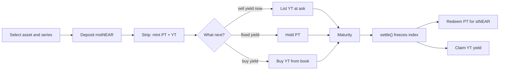
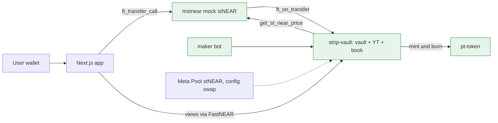
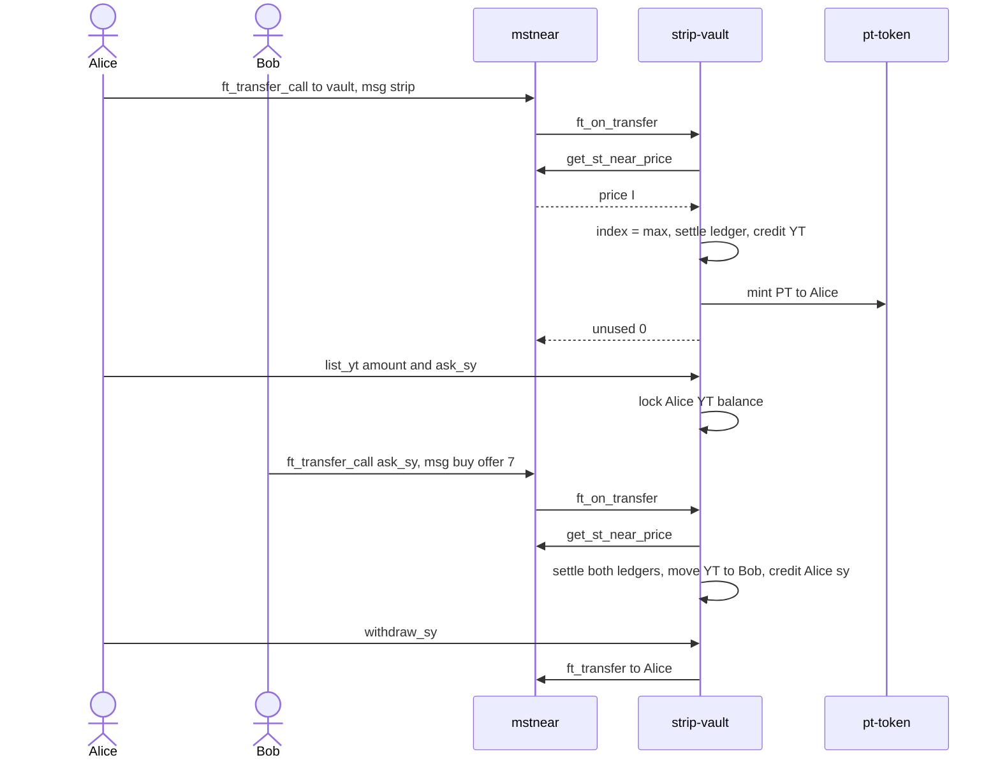
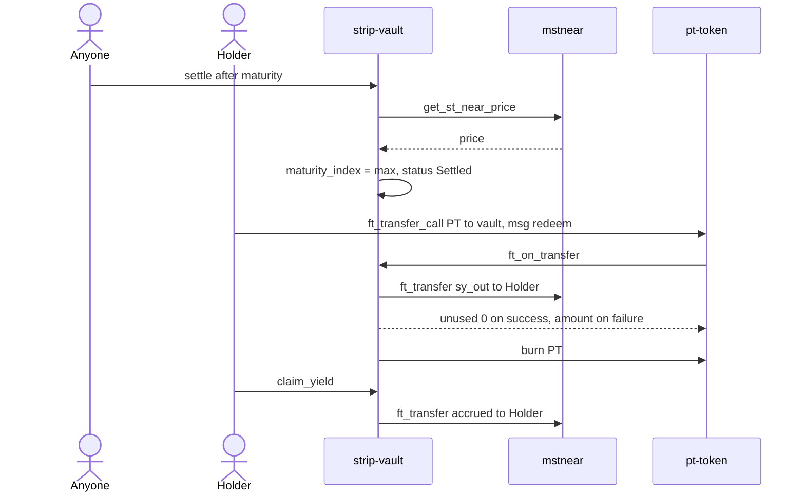
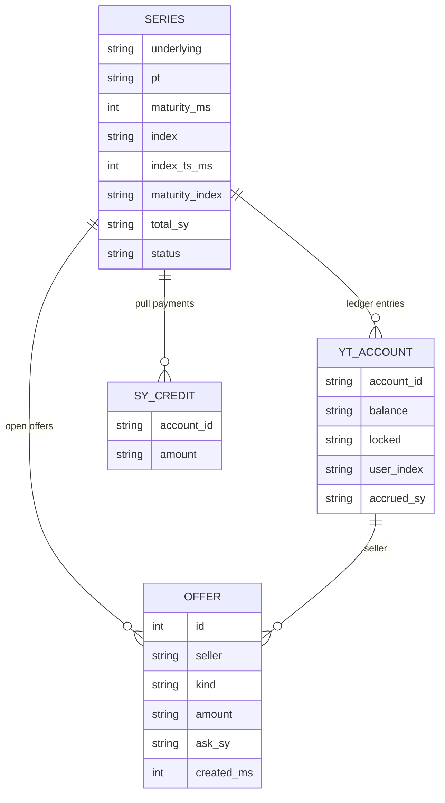

# Rhea Strip MVP: architecture, trading model, frontend flow, work split

- **Date**: 2026-11-09 · **Project**: Rhea Strip (NEAR hackathon) · **Mode**: Smart contract / web3 + Feature build
- **Status**: draft (decisions unconfirmed). The caller said "no interactive questions, decide with sensible defaults". Every default below is stated as a locked-by-default decision (D1 to D14) and the questions that could flip one are in **Open questions**. Builders may treat D1 to D14 as final unless the user answers otherwise.
- **Companion files**: none by request (single file). Diagrams are in section 7.
- **Hard deadline**: NEAR HACKATHON 2026-11-14 23:59 UTC (today is 2026-11-09, 5 days) [E14]. Everything below is sized for that.

## Context

- Repo is greenfield: only `docs/Rhea_Strip_MVP_PRD.md` and a 2.8 MB HTML style reference (`docs/Backgrounds Supply ...html`, inventoried by hackathon-pm, not read here). `docs/research/04-tooling.md` and `docs/handoffs/STATUS.md` exist from hackathon-pm.
- PRD MVP: deposit Meta Pool stNEAR, receive PT and YT, trade PT and YT independently (flagship: forward-selling yield), settle at maturity (PT redeem, YT claim). One underlying, one maturity series. Screens: Select Asset, Deposit, Strip, Trade, Portfolio, Maturity/Settle.
- Machine: Rust 1.99.1, `wasm32-unknown-unknown` installed, Node 26.12.1, pnpm 11.4, Docker 29. `cargo-near` and `near-cli-rs` are not installed (contracts builder installs them).
- Judging: an AI agent (Claude Code or Codex) first checks the project runs and does what the README says, then humans judge. Submission needs a public repo with README, a public X post tagging @NEARProtocol with #NEARHackathon and a video or screenshots, and a form with a NEAR wallet address [E14]. Best-fit track: Unstoppable DeFi, fallback Open Innovation. Mainnet vs testnet is not specified [E14].

## The question

What is the smallest architecture on NEAR that honestly demonstrates the full PT/YT journey, including forward-selling yield, can be built and deployed to testnet in 5 days by up to 4 builders, and does not lie about what is mocked.

## Decision

Build three Rust contracts on near-sdk 5.30.1, one Next.js 16 frontend, and a shared TypeScript SDK. The underlying is a faithful mock yield-bearing token that copies Meta Pool's interface, because real testnet stNEAR has a flat price. Trading is an on-chain offer book inside the vault contract, not an AMM and not a Ref/Rhea pool.

### Locked-by-default decisions

| # | Decision | Why (evidence) |
|---|---|---|
| D1 | Contracts in **Rust, near-sdk 5.30.1** (`near-contract-standards` 5.30.1, MSRV 1.95, nearcore 2.14 on both nets). Not JS. | `near-sdk-js` is archived and says "DEPRECATED, DO NOT USE"; docs call near-sdk-rs the only official SDK [E1][E2]. |
| D2 | **SY is stNEAR itself.** No wrapper contract. stNEAR is a price-appreciating, non-rebasing NEP-141 whose price is read with `get_st_near_price()`. | Verified on chain: `meta-v2.pool.testnet` and `meta-pool.near` both return a 24-decimal NEAR-per-stNEAR price [E3][E4]. A wrapper would add a contract for no gain. |
| D3 | **Underlying for the demo is `mstnear`, a mock token** with the same interface (`get_st_near_price`, `ft_*`, 24 decimals) and a controllable yield rate. The vault takes the underlying account id as config, so pointing it at `meta-v2.pool.testnet` or `meta-pool.near` is a config change, not a code change. | Real testnet stNEAR price is flat: identical value at 5 block heights across 7 days; LiNEAR testnet flat across 7 days [E5]. A 2-day demo cannot show yield on a flat price. |
| D3b | The UI shows live **mainnet** stNEAR price and approximate APY as a read-only reference card on Select Asset. Real integration evidence without pretending testnet yield. | Mainnet price history gives about 4.1% APY over 365 days [E4]. |
| D4 | **Demo clock compression**: protocol `year_secs` is a config value (demo default 3600, so 1 real hour is one protocol year; mainnet value would be 31,536,000). Mock yield and all quoted APYs use it. The UI labels it "demo clock". | At about 4% real APY and a 30-minute series the PT discount is about 1e-6, invisible. The math is homogeneous in time, so compression is faithful. |
| D5 | **Index = stNEAR price, scale 1e24, monotonic (high-water mark).** Vault stores `index`, `index_ts_ms`, and `maturity_index`. Pull it with a cross-contract view (`get_st_near_price`) inside a callback. | Pendle: `pyIndexCurrent = max(exchangeRate, stored)` [E8]. NEAR cannot read another contract synchronously. |
| D6 | **PT and YT are NEP-141.** PT is its own contract `pt-token` (plain FT, vault is sole minter/burner). **YT is the vault contract itself** (`strip.<root>`), with a per-account interest ledger. | Interest must be settled on every YT balance change; keeping the YT ledger in the vault removes a circular cross-contract dependency. |
| D7 | **Trading venue = offer book inside the vault**: a seller lists PT or YT at a price they choose, a buyer pays in stNEAR and fills it atomically. Full fills only. No fees. | Smallest thing that demos forward-selling yield; no LP, no curve, and no interest leakage (section "Trading"). |
| D8 | **YT listing locks the seller's own ledger balance** instead of moving YT to an escrow account. Interest keeps accruing to the seller until the fill. | A YT sitting in any other account (escrow contract, Ref pool) accrues interest to that account, not the seller [E9][E10]. |
| D9 | **Claim and redeem happen after settlement only.** `settle()` is permissionless, freezes `maturity_index` lazily on the first call after maturity. PT redeems at `maturity_index`; YT claim burns the YT balance and pays accrued stNEAR. Pre-maturity claim, merge (PT+YT to SY) and partial fills are cut. | Pendle freezes `firstPYIndex` on the first post-expiry call; post-expiry yield on principal does not go to PT or YT [E8]. PRD says "at maturity". |
| D10 | **No on-chain pricing math.** The book stores the maker's `ask_sy`. All PT/YT price quotes (compound formula) live in the TS SDK. | NEAR's VM rejects floating point (assumption A3), and a maker-priced book needs no curve. |
| D11 | **Frontend: Next.js 16 + React 19 + `@hot-labs/near-connect` (NEAR Connect) + `near-api-js` 7.x**, `testnet` set explicitly, views via FastNEAR RPC with failover. Not `@near-wallet-selector` (banner now prefers HOT Connect). | [E11][E12][E13]. |
| D12 | Deployment is **testnet only**, frontend on Vercel, one series per deployment, plus a `new-series` script that spins up a fresh contract set with a maturity a few minutes away so judges can run the whole journey. | Judges review 2026-11-16 to 11-18 [E14]; a fixed maturity in the past would show only the settle half. |
| D13 | **"First on NEAR" wording = "to our knowledge"**. | No NEAR PT/YT or fixed-rate protocol found on DefiLlama NEAR categories or GitHub search on 2026-11-09; absence is hard to prove [E15]. |
| D14 | **Index freshness**: every index-sensitive action (strip, buy, claim, redeem is post-settle so exempt) runs "pull price, then callback, then act" in one receipt chain. Raw YT `ft_transfer` pre-maturity requires `index_age <= 120 s` (else `E_STALE_INDEX`). Fallback if the callback chain eats the schedule: stored-index mode (section "Risks", Plan B). | Staleness on mint is value-neutral, staleness on redeem is exploitable; so redeem is only allowed after the index is frozen. |

## Options considered

### Underlying / yield source

| Option | Verdict |
|---|---|
| Real testnet stNEAR (`meta-v2.pool.testnet`) | Live (1.75M NEAR staked, epoch 5429) but price frozen since 2026-07-23 because nobody calls the permissionless `distribute_rewards`. A poke would step the price about +2.5% once (about 46.5K NEAR unclaimed rewards in 3 pools), unverified without a transaction. Stretch S4 "real-stNEAR mode": strip real testnet stNEAR (`deposit_and_stake` needs at least 1 NEAR) and poke `distribute_rewards` during the demo. Not the default because the step is one-off and uncontrollable [E5][E17]. |
| Real mainnet stNEAR | Real yield (about 4% APY) but needs mainnet funds, mainnet deploy risk, and invisible yield in a short window. Reference price only. |
| **Mock `mstnear` with Meta Pool's interface (chosen)** | Observable yield, deterministic demos, drop-in swap. Must be labelled "mock" everywhere. |

### PT/YT trading

| | Fixed-rate AMM (protocol quotes at admin APY) | Ref/Rhea SimplePool (PT/stNEAR, YT/stNEAR) | **Offer book in vault (chosen)** |
|---|---|---|---|
| Smallest demo of forward-sell | Instant fills | Works for PT, wrong for YT | Seller lists YT, buyer fills |
| Build effort (5-day window) | 2 to 3 days (inventory, rate admin, caps) | 1 day plumbing, plus risk | 1 to 1.5 days |
| Cold start | Seeded inventory | Seeded pool | Maker bot seeds offers |
| Correct pricing | Only as good as admin APY; free option to informed traders, systematic LP/treasury loss [E7] | Constant product has no time input, no maturity convergence; `add_stable/rated_swap_pool` are owner-only and rate providers hard-coded, so no time-decay pool is possible on Ref [E10] | Price is the maker's quote, honest and visible |
| Interest leakage | None if vault holds inventory | **Yes**: YT held in the exchange contract accrues to the exchange account, not LPs [E9][E10] | **None** (D8) |
| Fidelity to PRD future ("time-decaying AMM") | High | Low | Medium (book now, AMM later) |
| Works for judges alone | Yes | Needs liquidity | Needs seeded offers (script) |

Recommendation: the offer book. Pre-mortem answer: it fails if nobody is on the other side, so `seed-maker` ships and the UI has a "Quick fill" on the best offer. Condition that would change this pick: if the user wants an instant-fill demo more than a faithful one, add the fixed-rate "protocol bid" (stretch S1) on top of the book, not instead of it.

Prior art used for the shape: Exponent runs a Rate Order Book with no LP pool and escrowed YT keeps accruing; Pendle Limit Orders fill at a specified implied APY [E7].

## Spec

### 1. Contract topology and what is real vs mocked

| Piece | Testnet, real code | Mocked or simplified |
|---|---|---|
| `strip-vault` (vault + YT + offer book) | Real. All PRD flows. | One series per deployment; no fees; no merge. |
| `pt-token` | Real NEP-141 with minter gate. | Auto-registers on mint (vault absorbs storage). |
| Underlying `mstnear` | Real NEP-141. | **Mock yield**: price rises linearly at `apr_bps` per protocol year. Faucet mints test tokens. |
| Time | Real chain time | `year_secs` compressed (D4). |
| Counterparty liquidity | Real offers, real fills | Maker bot account seeds offers from `scripts/seed-maker`. |
| Mainnet stNEAR price card | Real view call | Read-only. |
| Rhea/Ref integration | None in MVP | Stretch S2: indicative PT/mstNEAR SimplePool on `ref-finance-101.testnet` (live, v1.9.19) [E10]. |

Realistic 5-day ship list: all three contracts deployed and tested in sandbox, frontend with all 6 screens wired to testnet, e2e script, README, video. See Work split for the day plan.

### 2. Yield accounting (Pendle SY/PT/YT math, integer form)

Definitions: `SCALE = 1e24`. `I` = stNEAR price (NEAR per stNEAR, scaled). PT and YT amounts are denominated in NEAR-asset terms (24 decimals). SY amounts are stNEAR. Use U256 for every multiply-then-divide (`yt * SCALE * (cur - prev)` overflows u128).

```
index        = max(stored_index, fetched_price)                 // never decreases
strip:   py  = floor(sy_in * I / SCALE)                          // mint py PT and py YT
interest:    accrued_sy += floor(yt_bal * SCALE * (I_cur - I_prev) / (I_prev * I_cur))
             first touch (user_index == 0): set user_index = I_cur, accrue 0
             settle BEFORE any YT balance change, for both parties
cap:         I_cur = min(index, maturity_index) once settled
settle():    once, at or after maturity: maturity_index = max(index, fetched_price)
redeem PT:   sy_out = floor(pt_amt * SCALE / maturity_index)    // after settle
claim YT:    pay accrued_sy (incl. pending to maturity_index), burn YT balance
rounding:    all floors, in the vault's favour
```

Invariant to test in a property test: `vault_sy_balance >= pt_supply*SCALE/I + sum(unclaimed_accrued)`; and `pt_supply == yt_supply` before maturity.

Index drop (slashing/depeg): the high-water mark means redeems pay `PT/stored_index` and the last redeemer absorbs any shortfall (Pendle behaviour) [E8]. Document it; do not build loss socialisation.

Residual: stNEAR price growth after `maturity_index` stays in the vault as residual. Owner method `sweep_residual()` can withdraw only `vault_balance - owed` after all PT/YT are settled. Optional; cut if short on time.

### 3. Maturity and settlement rules

| Phase | Condition | Allowed |
|---|---|---|
| Active | `now < maturity_ms` | strip, list/cancel/fill offers, YT transfer (index fresh), views |
| Matured | `now >= maturity_ms` and not settled | `settle()`, offers frozen (fills and strips revert `E_NOT_ACTIVE`), cancel allowed |
| Settled | `maturity_index` set | PT redeem, YT claim, withdraw credits, cancel |

`now >= maturity_ms` is inclusive (Pendle: `expiry <= block.timestamp`). Lazy settle means a late `settle()` caller credits slightly more yield to YT; the frontend calls `settle()` automatically when the Settle screen opens after maturity [E8].

### 4. Trading: how forward-selling yield works and the pricing formula

Flow: Alice strips 100 stNEAR (gets 150.xx PT and 150.xx YT in asset terms). She lists her YT at an ask in stNEAR. Bob pays the ask and receives the YT. Alice keeps PT (a fixed-yield position) and got the upfront liquidity. At maturity Bob claims the yield the YT accrued from his fill until maturity, plus Alice's accrued-before-fill interest stays with Alice (D8; settled into her ledger at fill, claimable by her at settlement).

Pricing (TypeScript SDK only, floats fine, D10). Let `r` = implied APY (annual effective), `τ = max(0, maturity_ms - now_ms)/1000 / year_secs`:

```
pPT(r)       = (1 + r)^(-τ)            // asset per asset, PT price
pYT(r)       = 1 - pPT(r)              // YT price (Pendle: YT = 1 - PT)
ask_sy(YT a) = a * pYT(r) / I_now      // a in asset units, I_now scaled by SCALE
ask_sy(PT a) = a * pPT(r) / I_now
implied r from an ask:  pPT = 1 - ask_asset/a (for YT) ; r = pPT^(-1/τ) - 1
buyer break-even:       I_maturity / I_now >= 1 / pPT = (1 + r)^τ
```

Worked check (r = 8%, τ = 0.5 protocol years, I = 1.5144): pPT = 0.9623, pYT = 0.0377, so listing 100 YT asks about 2.49 stNEAR. Simple-interest variant `pPT = 1/(1 + r·τ)` is acceptable for the on-chain Rust helpers if ever needed, with integer math only (derived, not from a source).

Book rules (market module):
- `Offer { id, seller, kind: Pt|Yt, amount, ask_sy, created_ms }`. At most 5 open offers per account (vault pays the storage). Full fill only: buyer sends exactly `ask_sy`; overpay is returned as unused, underpay reverts and refunds.
- YT offer: `amount <= yt_balance - yt_locked`; sets `yt_locked += amount`. Fill moves the ledger balance seller to buyer after settling both at the fresh index.
- PT offer: PT arrives by `pt.ft_transfer_call(vault, amount, {"action":"list_pt","ask_sy":"..."})` and is escrowed (PT has no interest, escrow is safe). Fill pays the buyer with `pt.ft_transfer`; on failure the buyer's stNEAR is refunded and the offer stays.
- Seller proceeds are recorded as `sy_credit[seller]` (pull payment) and withdrawn with `withdraw_sy()` so a seller who is unregistered on the underlying cannot block a fill.
- `cancel_offer` returns the lock or the escrowed PT. Offers cannot be created at or after maturity.

### 5. Contract interfaces (the contract between roles)

All amounts are `U128` decimal strings, 24 decimals. Timestamps are `U64` decimal strings in milliseconds. Account ids are plain strings. Errors are panic strings starting with the code: `E_NOT_ACTIVE`, `E_NOT_MATURED`, `E_NOT_SETTLED`, `E_STALE_INDEX`, `E_BAD_MSG`, `E_WRONG_TOKEN`, `E_OFFER_GONE`, `E_PRICE_MISMATCH`, `E_INSUFFICIENT_YT`, `E_MIN_AMOUNT`, `E_TOO_MANY_OFFERS`. Events follow NEP-297 with `"standard": "rhea_strip"` and events `strip`, `index_sync`, `list`, `fill`, `cancel`, `settle`, `redeem`, `claim`.

Accounts (all `<root>.testnet` subaccounts): `mstnear.<root>`, `pt.<root>`, `strip.<root>`, plus `maker.<root>` for the bot.

Sketch of shapes (labelled sketch, not implementation):

```text
// ---- mock-stnear (account mstnear.<root>) ----
new({ owner, p0: U128 /* default 1514411535945873749259456, mirrors mainnet */, apr_bps: u32, year_secs: U64 })
get_st_near_price() -> U128                 // p0 + p0*apr_bps*elapsed_s/(10000*year_secs)
faucet()                                    // mints 100 mstNEAR to predecessor, auto-registers, max 1000 per account
set_apr_bps({ apr_bps })                    // owner only
+ NEP-141, NEP-145, NEP-148 metadata (decimals 24, symbol "mstNEAR")

// ---- pt-token (account pt.<root>) ----
new({ minter: AccountId, name, symbol, maturity_ms })   // symbol e.g. "PT-mstNEAR-15NOV26"
mint({ account_id, amount })                // minter only, auto-registers account, vault pays storage
burn({ amount })                            // minter only, burns minter's own balance
+ NEP-141, NEP-145

// ---- strip-vault (account strip.<root>), also the YT NEP-141 ----
new({ owner, underlying, pt, maturity_ms, year_secs, min_strip: U128 })

// Views
get_series() -> {
  underlying, pt, yt, maturity_ms, year_secs,
  status: "Active" | "Matured" | "Settled",
  index: U128, index_ts_ms: U64, maturity_index: U128 | null,
  total_sy: U128, pt_supply: U128, yt_supply: U128
}
get_position({ account_id }) -> {
  yt_balance: U128, yt_locked: U128,
  yt_accrued_sy: U128,       // settled in ledger
  yt_pending_sy: U128,       // accrual from user_index to current index (display only)
  sy_credit: U128            // withdrawable sale proceeds
}
get_offers({ kind?: "Pt"|"Yt", from_index: u64, limit: u64 }) -> [Offer]
get_offer({ offer_id: U64 }) -> Offer | null
Offer = { id: U64, seller, kind: "Pt"|"Yt", amount: U128, ask_sy: U128, created_ms: U64 }

// Calls (gas = suggested attach, tune in sandbox, assumption A5)
sync_index()                                 // 50 TGas, anyone: pull price, store max
settle()                                     // 50 TGas, anyone, after maturity
list_yt({ amount, ask_sy }) -> U64           // 30 TGas, 1 yocto
cancel_offer({ offer_id })                   // 50 TGas, 1 yocto, seller only
claim_yield()                                // 100 TGas, 1 yocto, after Settled
withdraw_sy()                                // 80 TGas, 1 yocto, pays out sy_credit

// Token receivers (ft_on_transfer, predecessor decides the path)
underlying.ft_transfer_call(strip, amount, '{"action":"strip"}')                      // 300 TGas
underlying.ft_transfer_call(strip, ask_sy,  '{"action":"buy","offer_id":"7"}')        // 250 TGas
pt.ft_transfer_call(strip, amount, '{"action":"redeem"}')                             // 150 TGas, after Settled
pt.ft_transfer_call(strip, amount, '{"action":"list_pt","ask_sy":"..."}')             // 100 TGas
// any other token or malformed msg: return the full amount as unused

// YT as NEP-141 on strip: ft_transfer / ft_transfer_call / ft_balance_of / ft_total_supply /
// ft_metadata (symbol "YT-mstNEAR-15NOV26") + NEP-145 storage_*. ft_transfer blocks the locked part.
```

Strip chain (decision D14): `ft_on_transfer` returns a promise: `underlying.get_st_near_price()` then `on_index(Action::Strip{sender, amount})`, which updates index, settles the sender's YT ledger, credits YT, then `pt.mint(sender, py)`, returning `0` unused. Any failure returns the full amount as unused so NEP-141 refunds the user. Redeem and payout paths use the same trick: do the payout `ft_transfer` first, then a callback returns `0` on success or the PT amount on failure so the PT comes back.

Internal Rust seam between the two contract-side roles (so they can edit one crate in parallel):

```text
// owned by contracts-core (ledger.rs)
fn lock_yt(&mut self, acct: &AccountId, amt: u128)
fn unlock_yt(&mut self, acct: &AccountId, amt: u128)
fn move_locked_yt(&mut self, from: &AccountId, to: &AccountId, amt: u128, idx: u128)  // settles both first
fn credit_sy(&mut self, acct: &AccountId, amt: u128)
fn require_active(&self)
// owned by market (market.rs)
fn create_yt_offer, create_pt_offer(from ft_on_transfer), cancel_offer, fill_offer(after fresh index), get_offers
// lib.rs dispatcher (contracts-core) routes ft_on_transfer msg "list_pt" and "buy" into market.rs
```

### 6. Frontend flow

Stack (verified 2026-11-09 [E11][E12][E13]): Next.js 16.x, React 19.2, `@hot-labs/near-connect` (0.12.0, the official docs path), `near-api-js` 7.4.0 (Node 22.22.2 or newer), community hook wrapper `near-connect-hooks` is optional. Create a client-only provider with `new NearConnector({ network: "testnet", providers: { testnet: ["https://test.rpc.fastnear.com", "https://rpc.testnet.near.org"] } })`, subscribe to `wallet:signIn` and `wallet:signOut`, read views through a `FailoverRpcProvider`. Writes use `wallet.signAndSendTransaction` or `signAndSendTransactions` to batch `storage_deposit` plus the main call. Wallets flagged for testnet in the connector manifest: Meteor, Intear, Nightly, Ledger; HOT and MyNearWallet carry no flag, so pick Meteor or Intear for the demo [E11]. Set `testnet` explicitly (the `near-dapp` skill examples default to mainnet). Visual system follows the Backgrounds Supply reference as inventoried by hackathon-pm in `docs/research/`; the frontend builder reads that inventory first.

| Screen | Route | Purpose | States to build |
|---|---|---|---|
| Select Asset | `/` | pick underlying and series | loading, wallet disconnected, wrong network, ready. Cards: stNEAR (active, mock label, live mainnet stNEAR price/APY reference), LiNEAR, RHEA LP, USDY/BUIDL (disabled "coming"). One series card with maturity countdown and demo-clock note |
| Deposit and Strip | `/strip` | amount in, preview PT/YT out | no mstNEAR (faucet CTA), unregistered tokens (auto-batch `storage_deposit`), index stale (auto `sync_index`), pending multi-step progress, success with PT and YT amounts, tx error with explorer link |
| Trade | `/trade` | PT/YT markets, Forward-sell hero | tabs PT / YT; YT tab hero "Sell future yield": APY slider drives upfront stNEAR preview via the pricing formula, "List" button; offer list with Buy; empty book (CTA to list, hint that the maker bot seeds), own offers with Cancel, offer gone/filled race error |
| Portfolio | `/portfolio` | PT/YT balances, accrual, status | disconnected, empty, ticking YT accrual (poll `get_series` index every 10 s, compute with SDK), listed amounts, sale credit with Withdraw |
| Maturity and Settle | `/settle` | settle, redeem, claim | before maturity (countdown, disabled), matured-not-settled (auto-call `settle()`), settled (Redeem PT, Claim YT, Withdraw), done |

Tx orchestration rules: before any index-sensitive action, if `index_age > 20 s`, fire `sync_index` and wait for its final status; always batch `storage_deposit` for every token the user will receive; show each step as a stepper. Never hold keys in the repo or `.env`.

### 7. Diagrams

User journey:



_Caption: every path ends at settle, then PT redeem and YT claim._

Contract topology:



_Caption: three new contracts; the real Meta Pool contract plugs in through the underlying id config (dotted)._

Deposit, strip and trade:



_Caption: forward-selling yield is steps list_yt to withdraw_sy; no AMM involved._

Settlement:



_Caption: after settle, redeem and claim need no price read. Failure of the payout returns the PT or restores the ledger._

Data model:



_Caption: one SERIES per deployment; PT balances live in the external pt-token contract, not here._

Mermaid blocks checked with `~/.claude/skills/brainstorm/scripts/check-mermaid.sh` (see Evidence).

### 8. Security checklist (builder and `near-contract-audit` pass)

1. `ft_on_transfer`: check `predecessor_account_id` is the underlying or `pt`; anything else returns the full amount unused. [E6]
2. Index high-water mark; reject price 0; settle YT interest before any balance change, for both parties; first-touch rule. [E8]
3. Do not derive accounting from `ft_balance_of`; use internal counters from `ft_on_transfer` amounts (donation attack, first depositor). `min_strip` as an inflation floor. [E8]
4. Deduct state before cross-contract calls; callbacks never panic; every payout has a rollback path. [E6]
5. 1 yocto on `claim_yield`, `withdraw_sy`, `cancel_offer`, `list_yt`; callbacks `#[private]`.
6. Mint blocked at `now >= maturity_ms`; settle lazy; all rounding floors in the vault's favour. [E8]
7. Storage: vault is pre-funded and pays for ledger entries on mint; cap 5 offers per account; `min_strip` makes spam expensive. Accepted risk (A6).
8. U256 for all mul-div. Property test the conservation invariant.

### 9. Test strategy

- Unit tests per ledger function (near-sdk 5.30 mock now uses real host functions; some older tutorials differ [E1]).
- Sandbox integration tests: follow the `cargo near new` template stack (`near-sandbox` + `near-api`), not both stacks; `near-workspaces` 0.24 also works [E1].
- Scenarios: strip, two stripers with different indexes, list then fill YT with accrual attribution, PT list and fill, settle then redeem then claim, failure refunds (unregistered receiver), stale-index revert, wrong-token refund, index never decreases, rounding conservation fuzz.
- E2E testnet script `scripts/e2e.ts` runs the PRD's five success criteria headless and prints explorer links (this is what a judge agent can run).

### 10. Work split (max 4 roles) and 5-day schedule

Repo layout: `contracts/{mock-stnear,pt-token,strip-vault}`, `packages/sdk` (TS: ABI types, units, pricing, views), `apps/web` (Next.js), `scripts/` (deploy, new-series, seed-maker, e2e, keeper), `docs/`.

| Role | Owns | Interface it consumes or produces |
|---|---|---|
| **R1 contracts-core** | `mock-stnear`, `pt-token`, `strip-vault` core (index, strip, settle, redeem, claim, YT NEP-141 and interest ledger, `ledger.rs`), sandbox tests, testnet deploy | Produces section 5. Freeze the JSON shapes in the first 2 hours; publish `packages/sdk/abi.ts` as the single typed source. |
| **R2 frontend** | `apps/web`: 6 screens, wallet provider, tx stepper, design system from the style reference | Consumes `packages/sdk` only. Starts against a `FakeChain` adapter in the SDK, switches to testnet when R1 lands. Never calls contracts directly outside the SDK. |
| **R3 trading + integration** | `market.rs` (offer book), `packages/sdk` (pricing, offers, views), scripts (`deploy`, `new-series`, `seed-maker`, `e2e`, `keeper`), maker bot account, stretch S1/S2 | Implements the internal seam in section 5, owns pricing formula tests, owns the e2e that proves the 5 PRD criteria. |
| **R4 PM, demo, docs** | README (judge-agent friendly: exact commands, expected output), demo script and video, X post, submission form, QA checklist, hosted-site smoke test with Playwright, risk log | Gates: contracts-ready, UI-wired, e2e green, submitted by 2026-11-14 12:00 UTC. |

Day plan: 11-09 skeleton, mock token, ABI frozen. 11-10 R1 strip/settle in sandbox, R2 screens on FakeChain, R3 book skeleton. 11-11 R1 YT ledger plus redeem/claim, R3 fills, R2 wires testnet views. 11-12 testnet deploy, e2e green, R2 trade/portfolio/settle. 11-13 polish, maker seeding, README, video, hosted site. 11-14 buffer and submit (target 12:00 UTC, deadline 23:59 UTC).

### 11. Risks, cuts, pre-mortem

| Risk | Handling |
|---|---|
| 5-day deadline | Cut list below; vertical slice on day 1 |
| Async index chain (strip, buy) takes too long to get right | **Plan B**: stored-index mode. All index-sensitive actions require `index_age <= 120 s` else refund `E_STALE_INDEX`; frontend and keeper call `sync_index` first. Same interfaces. Decide on 11-10 EOD |
| Cold-start liquidity | `seed-maker`, "Quick fill" on best offer |
| Mock yield looks like fakery | Label "mock stNEAR, demo clock" in UI and README; show real mainnet reference price |
| Testnet RPC/wallet flake | FastNEAR first, `rpc.testnet.near.org` failover; demo with Meteor or Intear; fallback video of a clean run |
| Judge agent cannot run the project | README quick start is one command (`pnpm e2e:testnet`) plus hosted URL; `new-series` for a fresh maturity |
| Storage-staking drains vault | Pre-fund 20+ NEAR, caps, `min_strip` (A6) |
| Lazy settle credits late-caller yield to YT | Frontend auto-settles; documented as Pendle behaviour [E8] |
| "First on NEAR" challenged | Use "to our knowledge" (D13) |
| near-sdk 5.30 test mock breaking change | Follow template stack, read CHANGELOG [E1] |

Cut order if behind: S3 history feed, S2 Ref pool, partial fills, PT offers (keep YT only), residual sweep, the LiNEAR/RHEA LP cards beyond "coming soon". Stretch: S1 fixed-rate protocol bid on YT; S2 indicative PT pool on `ref-finance-101.testnet`; S4 real-stNEAR mode (strip real `meta-v2.pool.testnet` stNEAR, poke permissionless `distribute_rewards` for a one-off real yield step, see E17).

Faithfulness rule for `mstnear` and the vault (from Meta Pool's real behaviour [E17]): the mock must require NEP-145 registration for receivers exactly like stNEAR, and the vault calls `storage_deposit` on the underlying at init (0.00125 NEAR), otherwise `ft_transfer_call` into the vault fails on the real contract.

Pre-mortem: "It is 2026-11-14 and it failed." Most likely causes, in order: callback chain bugs eating 2 days (Plan B), wallet signing flake on the demo machine (backup video, two wallets tested), yield not visible in a short demo (demo clock plus `set_apr_bps`).

## Out of scope

LiNEAR, RHEA LP, USDY/BUIDL, NEAR Intents onboarding, multiple series, fees and treasury, time-decay AMM, pre-maturity claim, merge, partial fills, mainnet deployment, indexer or price chart, audit, governance, upgradeability beyond owner-only redeploy.

## Open questions

1. Confirm D3 (mock underlying) and D4 (compressed demo clock). Alternative: real testnet stNEAR with static price, yield shown only as a simulation. Recommend mock.
2. Is the book-inside-vault merge (D6, D7, D8) acceptable, or does the team want a separate book contract (costs: interest leakage handling)? Recommend keep merged.
3. Team size and who maps to R1 to R4. If fewer than 4 people, merge R3 into R1 and R4 into R2.
4. Which hackathon track(s) to enter (default Unstoppable DeFi plus Open Innovation); confirm with NEAR submission form.
5. Hosted frontend on Vercel? Default yes.
6. Maker bot: who funds it and holds its key (key stays in OS keychain, never the repo).
7. Real-stNEAR mode (S4): worth a spare hour on 11-13 to run it against `meta-v2.pool.testnet` and call `distribute_rewards` for a real yield step? Default: only if everything else is green.
8. Meta Pool details now verified from source and RPC [E17]: `deposit_and_stake` (payable, min deposit 1 NEAR, auto-registers and takes 0.00125 NEAR), `liquid_unstake`, delayed unstake about 4 epochs, `ft_transfer_call` needs the receiver registered. No transaction was sent, so write paths are source-read, not executed.

## Tooling

- **Installed** (by hackathon-pm per `docs/research/04-tooling.md`, project scope, source https://github.com/near/agent-skills commit `cb32b6af`): skills `near-smart-contracts`, `near-contract-audit`, `near-cli-rs`, `near-dapp`, `near-api-js`; MCP `near-docs` (https://docs.near.org/mcp), `context7`, `playwright`. Skills visible in this session's skill list confirm the five NEAR skills are loaded.
- **Recommended, not installed**: Vercel Next devtools MCP, only if frontend wants runtime-error access: `claude mcp add --scope project next-devtools -- npx -y next-devtools-mcp@0.4.0` (from the hackathon-pm tooling file). Local toolchain installs for the contracts builder: `cargo install --locked cargo-near` and `cargo install --locked near-cli-rs` (heavy builds, not done here).
- **Rejected**: `nearai/near-mcp` (last push 2025-05-04, key handling) [E2]; `near-sdk-js` (archived) [E2]; `@near-wallet-selector/*` for new work (banner prefers HOT Connect) [E11]; Stellar and Solana skills on this machine do not apply.
- **Needs the user**: approve project MCP servers on first launch; testnet faucet funding (at least 20 testnet NEAR across deploy and maker accounts, assumption A6); wallet extension for demo (Meteor or Intear).

## Evidence

Read on 2026-11-09 unless noted. "V" marks facts I verified myself by RPC.

| # | Fact | Source | Confidence |
|---|---|---|---|
| E1 | near-sdk 5.30.1 current, MSRV 1.95, nearcore 2.14, near-contract-standards 5.30.1, cargo-near 0.23.0, near-workspaces 0.24.0, 5.30.0 test-mock breaking change, `cargo near new` template uses near-sandbox 0.4.0 + near-api 0.8 | https://crates.io/api/v1/crates/near-sdk ; https://raw.githubusercontent.com/near/near-sdk-rs/master/CHANGELOG.md ; https://github.com/near/cargo-near/blob/main/CHANGELOG.md | high |
| E2 | near-sdk-js archived and deprecated; docs call near-sdk-rs the only official SDK; `nearai/near-mcp` stale since 2025-05-04 | https://github.com/near/near-sdk-js ; https://docs.near.org/smart-contracts/quickstart.md ; https://github.com/nearai/near-mcp | high |
| E3 V | Testnet stNEAR `meta-v2.pool.testnet`: `ft_metadata` name "Staked NEAR", symbol STNEAR; `get_st_near_price` = 3198752259237337050198977; `get_contract_state` shows epoch 5429, about 1.75M NEAR staked, `ft_price` method not present; mainnet `meta-pool.near` | RPC view calls on https://test.rpc.fastnear.com and https://archival-rpc.mainnet.fastnear.com | high |
| E4 V | Mainnet `meta-pool.near` `get_st_near_price`: 1514411535945873749259456 now (height 223772128) vs 1511639313751181758127197 at height minus 2,592,000 (about 30 days). (Superseded: my 30-day estimate assumed 1 s blocks and was wrong; E17 uses dated samples.) | archival-rpc.mainnet.fastnear.com | low, see E17 |
| E5 V | Testnet stNEAR price identical at heights H, H-43200, H-86400, H-259200, H-604800 (H = 276925028); LiNEAR `linear-protocol.testnet` `ft_price` = 2284175768908950653602947 identical at H, H-86400, H-604800 | https://archival-rpc.testnet.near.org | high |
| E6 | NEP-141 mechanics: `ft_transfer_call` then `ft_on_transfer` (returns unused) then `ft_resolve_transfer`; SDK resolver 5 TGas; receiver checklist (check predecessor, return amount for unexpected tokens); NEP-145 storage minimum about 0.00235 NEAR | https://github.com/near/NEPs/blob/master/neps/nep-0141.md ; https://github.com/near/NEPs/blob/master/neps/nep-0145.md ; https://docs.near.org/smart-contracts/security/cross-contract-calls/ft-transfer-call.md | high |
| E7 | Pendle AMM math and flash-swap YT; Exponent Rate Order Book (no LP, escrowed YT accrues); Pendle Limit Orders; fixed-rate pool failure modes (derived) | https://raw.githubusercontent.com/pendle-finance/pendle-v2-resources/main/whitepapers/V2_AMM.pdf ; https://docs.exponent.finance/developer-orderbook/concepts ; https://docs.pendle.finance/pendle-v2-dev/LimitOrder/Overview | high for Pendle, medium for Exponent |
| E8 | Pendle SY index, `max()` high-water mark, mint/redeem rounding, per-user interest `ytBal*(1/prev - 1/cur)`, settle on transfer, first-touch rule, lazy `firstPYIndex`, inclusive expiry, post-expiry yield to treasury | https://raw.githubusercontent.com/pendle-finance/pendle-core-v2-public/main/contracts/core/YieldContracts/PendleYieldToken.sol ; .../InterestManagerYT.sol ; https://raw.githubusercontent.com/pendle-finance/pendle-v2-resources/main/whitepapers/SYS.pdf | high |
| E9 | Spectra and Sense settle YT yield on transfer (`beforeYtTransfer`, `collect` on transfer) | https://raw.githubusercontent.com/perspectivefi/spectra-core/main/src/tokens/PrincipalToken.sol ; https://raw.githubusercontent.com/sense-finance/sense-v1/dev/pkg/core/src/Divider.sol | high |
| E10 | Rhea is Ref rebranded; exchange `v2.ref-finance.near` (v1.9.21) and testnet `ref-finance-101.testnet` (v1.9.19, 2930 pools) live; only `add_simple_pool` is permissionless; stable/rated pools owner-only with hard-coded rate providers; SimplePool is constant product (no time input); testnet pool creation needs `storage_deposit` min 0.00102 NEAR and `register_tokens`; `@ref-finance/ref-sdk` 1.5.0 | RPC `metadata` view calls; https://github.com/ref-finance/rhea-sdk ; mirror https://github.com/DevOfCredit/ref-contracts (source repo ref-finance/ref-contracts returned 404) | high (on-chain), medium (source via mirror) |
| E11 | `@near-wallet-selector/core` 10.1.4 (2025-12-04) with banner recommending HOT Connect; `@hot-labs/near-connect` 0.12.0 (2026-10-26) is the official docs path; testnet-flagged wallets in manifest: Meteor, Intear, Ledger, Nightly, WalletConnect, Unity, Ethereum Wallets, NEAR CLI | https://docs.near.org/tools/near-connect.md ; https://raw.githubusercontent.com/azbang/near-connect/main/repository/manifest.json ; https://registry.npmjs.org/@near-wallet-selector/core | high (versions), medium (testnet claims untested) |
| E12 | near-api-js 7.4.0 (2026-10-23), Node >= 22.22.2; reference stack in hello-near-examples: next 16.2.10, react 19.2.7, near-connect 0.11.4 | https://registry.npmjs.org/near-api-js/latest ; https://raw.githubusercontent.com/near-examples/hello-near-examples/main/frontend/package.json | high |
| E13 | Testnet RPC: FastNEAR `https://test.rpc.fastnear.com` listed in docs; `rpc.testnet.near.org` answers but is not in the official table; `archival-rpc.*.near.org` prints a deprecation error on older blocks, use `https://archival-rpc.testnet.fastnear.com` and `https://archival-rpc.mainnet.fastnear.com` instead; nearblocks API v1 retired 2026-11-05, use v3; nearblocks testnet link may 403 to curl | https://docs.near.org/api/rpc/providers.md ; live curl; archival call 2026-11-09 | high / medium |
| E14 | NEAR HACKATHON 2026: dev window 2026-11-01 to 11-14, deadline 2026-11-14 23:59 UTC, judging 11-16 to 11-18, $250k, 13 tracks (Unstoppable DeFi fits), AI check then human judges, public repo + README + public X post + form incl. NEAR wallet address, max 2 projects per person, no stated mainnet/testnet requirement, Rhea listed as partner without a specific track | https://nearhackathon.com | high |
| E15 | No PT/YT or fixed-rate protocol on NEAR found (DefiLlama NEAR categories, GitHub search); Pendle expansions are Solana, Hyperliquid, TON | https://api.llama.fi/protocols ; https://blockworks.co/news/pendle-2025-outlook | medium (absence) |
| E16 | Yield-token security pitfalls (rounding direction, ERC-4626 inflation and donation, settle on transfer) | https://eips.ethereum.org/EIPS/eip-4626 ; https://docs.openzeppelin.com/contracts/5.x/erc4626 ; Ackee Pendle V2 audit summary https://ackee.xyz/blog/pendle-finance-pendle-v2-audit-summary/ | medium to high |
| E17 V | Meta Pool via a second research pass: testnet `meta-v2.pool.testnet`, mainnet `meta-pool.near`; non-rebasing, `ft_balance_of` = shares, price = `total_for_staking/total_stake_shares`; mainnet price 1.45453 (2025-11-04) to 1.51441 (2026-11-09) = about 4.1% APY; testnet price frozen since 2026-07-23 (3.19875, last step block 260,582,086 to 260,583,307) because `distribute_rewards(sp_inx: u16)` is not being called (4 of 106 pools staked, last asked epoch 5051 vs current 5429, about 46.5K NEAR unclaimed); `ft_price` absent, `get_st_near_price` is the view; min deposit 1 NEAR; `storage_balance_bounds` 0.00125 NEAR; `deposit_and_stake`, `liquid_unstake`, `unstake` (about 4 epochs), `ft_transfer_call` 1 yocto and registered receiver; LiNEAR `linear-protocol.testnet` `ft_price` also frozen; no transactions sent | https://docs.metapool.app/master/for-developers/meta-pool-contracts/near-network.md ; https://github.com/Meta-Pool/liquid-staking-contract ; RPC view calls on fastnear archival nodes | high (views), medium (write paths from source) |

**Diagram check**: `~/.claude/skills/brainstorm/scripts/check-mermaid.sh` on this file returned `ok (5 diagrams)` on 2026-11-09.

**Assumptions** (not evidence): A1 (retired) my block-time based APY estimate; replaced by E17's dated samples. A2 mock yield linear in time is acceptable for a demo. A3 NEAR's wasm VM rejects floating-point instructions (widely stated, not re-verified here; matters only for D10 and the TS-only pricing is safe either way). A4 FastNEAR free-tier limits are unpublished, treat as rate limited. A5 gas figures in section 5 are starting guesses; no published recommended total for `ft_transfer_call` was found, tune in sandbox. **A6 (riskiest)**: the vault can absorb ledger storage costs and the team can raise at least 20 testnet NEAR from faucets in time; if not, switch YT registration to explicit `storage_deposit` with the user paying. A7 Meta Pool `deposit_and_stake`, unstake delay and `liquid_unstake` signatures are unverified (Meta Pool README lists features only).

## Handoff

- **Agent**: `hackathon-pm` (multi-role project, turns this into at most four handoffs under `docs/handoffs/`), then the builders it dispatches.
- **Prompt** (paste as is): `@agent-hackathon-pm turn docs/brainstorm/rhea-strip-mvp-architecture.md into four handoffs (R1 contracts-core, R2 frontend, R3 trading+integration, R4 PM/demo/docs) using its section 5 interfaces verbatim, the decisions D1 to D14 as locked defaults, the section 10 day plan with the 2026-11-14 23:59 UTC deadline, and the installed NEAR skills (near-smart-contracts, near-contract-audit, near-cli-rs, near-dapp, near-api-js). Surface Open questions 1 to 8 to the user before dispatching anything.`
- **Acceptance criteria** (maps to PRD success criteria 1 to 5 plus judge-readiness):
  - [ ] Deposit mstNEAR via `ft_transfer_call` with `{"action":"strip"}` and receive PT and YT on testnet.
  - [ ] PT and YT balances show in the Portfolio screen, YT accrual ticks as the mock index grows.
  - [ ] YT offer can be listed and filled by a second account; seller interest before the fill stays with the seller (test attributes it).
  - [ ] PT offer can be listed and filled.
  - [ ] After maturity, `settle()` freezes the index, PT redeems at `maturity_index`, YT claim pays accrued stNEAR and burns YT.
  - [ ] All failure paths refund (wrong token, malformed msg, unregistered receiver, stale index).
  - [ ] Index never decreases; conservation property test passes.
  - [ ] `pnpm e2e:testnet` runs the five PRD criteria and prints explorer links; README quick start works from a clean clone; hosted site loads on testnet with a labelled "mock stNEAR, demo clock".
  - [ ] `near-contract-audit` checklist run on `strip-vault` before the testnet deploy.
  - [ ] Submission artefacts ready by 2026-11-14 12:00 UTC (repo, README, X post with #NEARHackathon and @NEARProtocol, form with wallet address).
- **References**: PRD `docs/Rhea_Strip_MVP_PRD.md`; `docs/research/04-tooling.md`; `docs/handoffs/STATUS.md`; Evidence table above.
